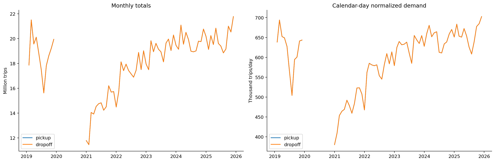

# Exploring Ride-Sharing Travel Behavior Patterns

NYC high-volume for-hire vehicle (HVFHV) demand: data preparation, baseline demand, temporal and spatial exploration, and hourly taxi-zone pickup forecasting.

**Author / maintainer:** FTFever. **Code license:** MIT. Source datasets retain their providers' terms and are not uploaded.

## Start here

1. Read [data sources and attribution](docs/DATA_SOURCES.md).
2. Follow [installation, directory configuration and notebook execution](docs/REPRODUCIBILITY.md).
3. Read [quality limitations and time definitions](docs/DATA_LIMITATIONS.md).
4. Review [forecasting design and evaluation](docs/MODELING.md) and the [feature dictionary](src/forecasting/feature_dictionary.csv).

All paths are configured in the first notebook code cell. Download source data separately or point these settings to your existing local files. No private drive layout is required.

## Workflow

| Notebook series | Purpose |
|---|---|
| 01 | Source ingestion |
| 02 | Preparation, earlier-year additions and staged repairs; overlapping historical implementations |
| 03 | Baseline demand, coverage and anomalies |
| 04 | Temporal pickup patterns |
| 05 | Spatial patterns and zone maps |
| 06 | Feature engineering, ARIMA, Random Forest, XGBoost, neural network tuning, SHAP and error diagnosis |
| 07 (planned) | Compare training-history lengths |

[Browse notebooks](notebooks/) and [saved visual results](reports/published/README.md). Notebook 06 defaults to review mode: choose features or full deliberately. Models predict the entire first week of 2026 using training data from 2021–2025. Existing research logs show one completed Random Forest candidate/fold; full tuning and model selection are not yet complete. No model training was run for this publication.

The published PNGs are existing analysis outputs, not newly regenerated results. See their inventory for provenance and limitations. Dataset tables, raw/processed Parquet, feature matrices, prediction datasets, fitted model files, credentials, notebook outputs and packaged Tableau data are excluded. The historical showcase remains in [archive](archive/legacy-showcase/).

[Public Tableau dashboard](https://public.tableau.com/views/RideSharingTripDemandPattern/Ride-SharingTravelBehaviorPatterninNYC2025) is a separate historical presentation and may reflect a different processing snapshot.

## Contributing and citation

See [CONTRIBUTING](CONTRIBUTING.md), [CITATION.cff](CITATION.cff) and [MIT license](LICENSE). Report reproducibility issues with the notebook name, Python/package versions and a sanitized traceback; never attach source datasets or credentials.
