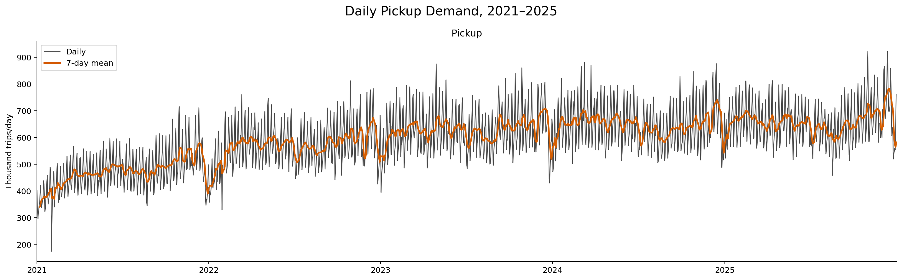
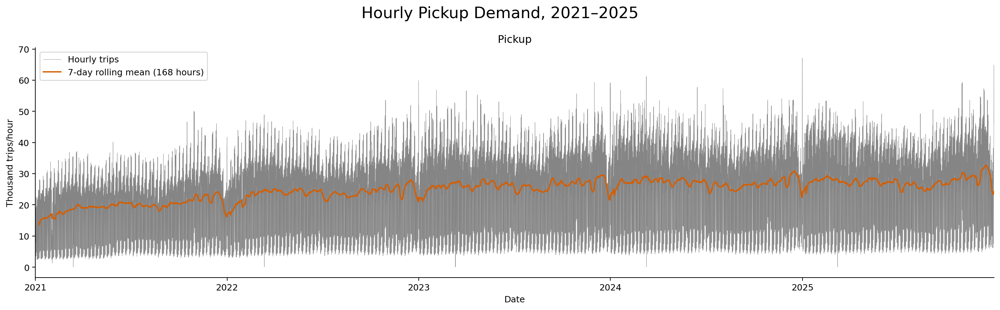
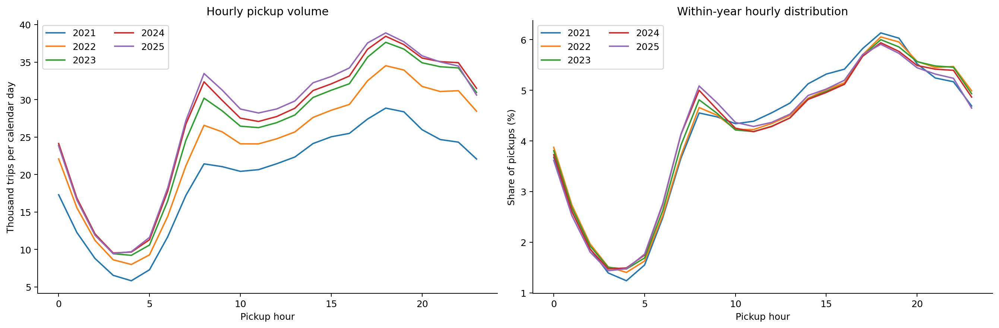
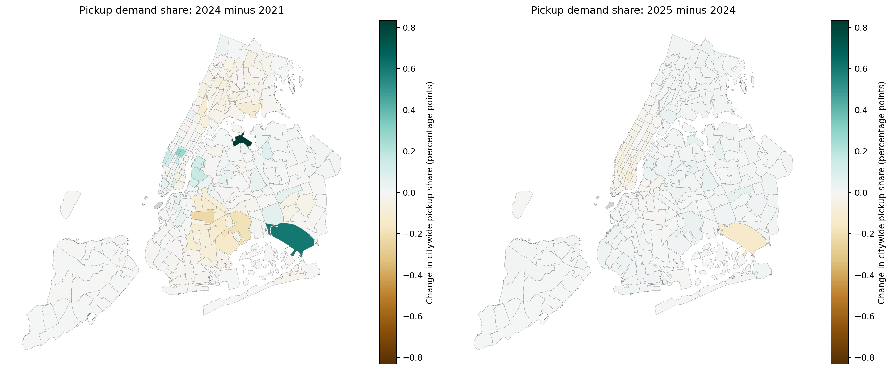
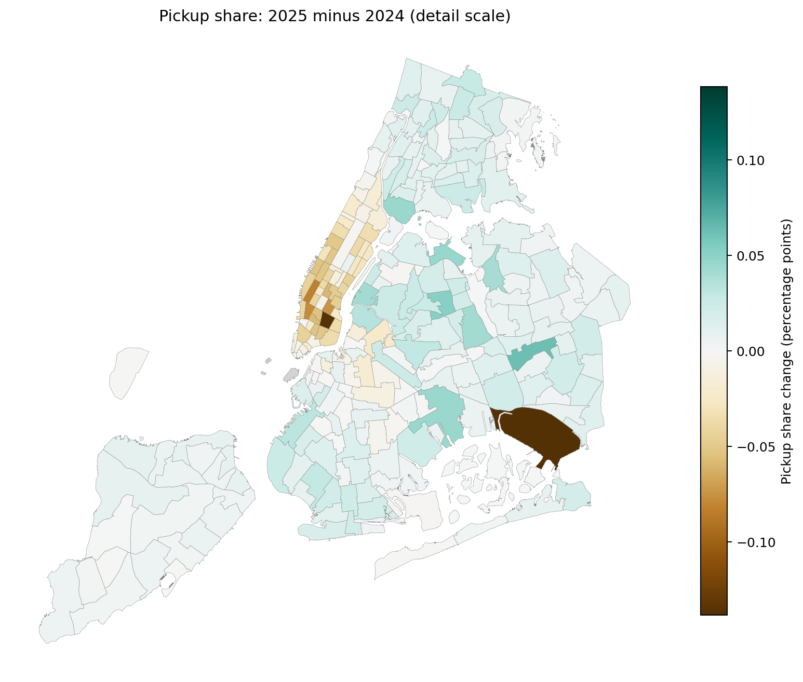
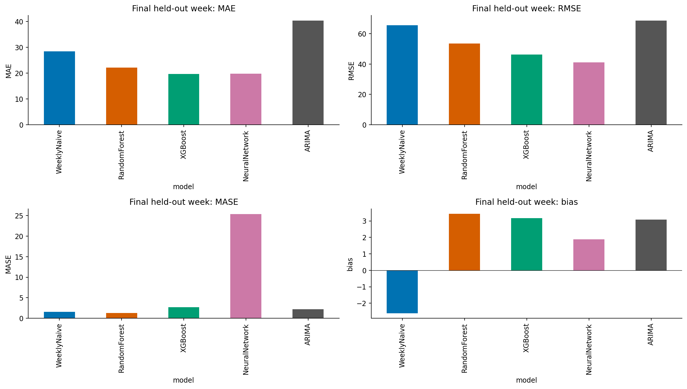
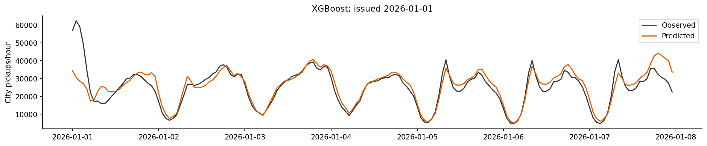
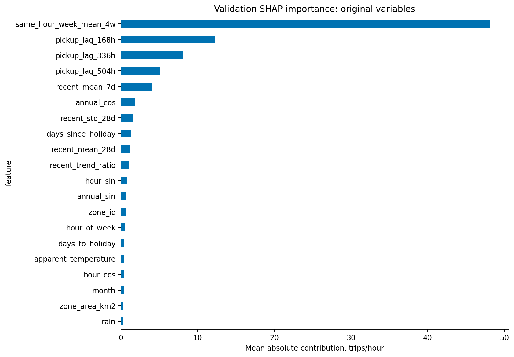

# Exploring Ride-Sharing Travel Behavior Patterns

## Research purpose

This repository presents part of an ongoing research project to understand **ridesharing travel behavior and forecast its demand in New York City**. It connects data preparation, descriptive analysis and predictive modeling: where pickups occur, how demand varies over hours, days and seasons, how its spatial distribution changes, and how accurately future hourly activity can be forecast at the taxi-zone level.

The current repository exhibits the project's **pickup-demand workflow and results**. It uses NYC Taxi and Limousine Commission high-volume for-hire vehicle (HVFHV) records across recorded platforms, together with taxi-zone geography, calendar/holiday features and hourly weather. It is not an Uber-only dataset. The focus is cleaned observed trip totals rather than requests, unmet demand, vehicle availability or duration.

**Maintainer:** FTFever · **Code license:** [MIT](LICENSE) · **Data:** obtained separately from the [documented sources](docs/DATA_SOURCES.md); datasets are not uploaded.

### Study period and forecast task

- **Baseline, temporal and spatial analysis:** January 2021–December 2025, covering 60 checked monthly pickup tables.
- **Forecast training:** 2021–2025, with expanding-window validation at four forecast origins in 2025.
- **Held-out forecast:** all 168 hours of January 1–7, 2026, predicted at the zonal level from one forecast origin. This reserved test week is separate from the descriptive study period.

## Workflow and notebooks

| Stage | Notebook | What it contains |
|---|---|---|
| Ingestion | [01](notebooks/01_data_ingestion.ipynb) | Source acquisition and inspection |
| Preparation | [02a: 2021–2023](notebooks/02a_prepare_hourly_2021_2023.ipynb) | Cleaning, features, hourly pickup/dropoff/OD aggregates and checkpoints |
| Preparation | [02b: 2024–2025](notebooks/02b_prepare_hourly_2024_2025.ipynb) | The remaining two years of hourly aggregates |
| Validation | [02c: selected repairs](notebooks/02c_validate_selected_repairs.ipynb) | Four staged outputs and validation; no automatic promotion |
| Baseline | [03](notebooks/03_analysis_baseline_demand.ipynb) | Coverage, totals, daily and hourly pickup trends |
| Temporal | [04](notebooks/04_analysis_temporal_patterns.ipynb) | Hour, weekday, weekend and monthly profiles; recorded findings |
| Spatial | [05](notebooks/05_analysis_spatial_patterns.ipynb) | Pickup maps, concentration and share changes; recorded findings |
| Forecasting | [06](notebooks/06_model_hourly_demand_forecasting.ipynb) | Features, tuning, ARIMA/RF/XGBoost/neural networks, SHAP, errors and completed results |

The 02 series now has three explicit stages. Superseded versions remain locally and have been removed from the current GitHub tree. Each notebook starts with directory configuration. Notebook 06 defaults to **review** mode; choose **features** or **full** deliberately before generating features or training. See the [execution guide](docs/REPRODUCIBILITY.md) for dependencies, paths and run order.

## Pickup-demand findings

### Daily and hourly trends

Average daily cleaned pickups increased from about **470,575 in 2021 to 658,304 in 2025**, a **39.9%** increase. This describes growth from the 2021 starting level without attributing it to a particular cause. Daily variability remains substantial, so the weekly rolling mean helps show longer changes.



Hourly trends retain the within-day cycle rather than reducing the prediction target to daily totals.



### Temporal patterns

The annual average hourly profile peaks at **18:00 in every year**. Saturday has the highest average daily pickups and Monday the lowest throughout 2021–2025. Monthly demand generally weakens in summer and strengthens toward year-end, with meaningful differences across years. Volume and normalized hourly share answer different questions; notebook 04 shows both.



Read the [quantified temporal findings](docs/TEMPORAL_FINDINGS.md) for annual totals, monthly extrema and interpretation limits.

### Spatial patterns and demand-share changes

The ten busiest pickup zones account for **12.90%** of citywide cleaned pickups in 2025. LaGuardia and JFK lead the zone ranking. The following maps compare each zone's fraction of citywide pickups on a shared color scale: **2024 minus 2021** and **2025 minus 2024**. Changes are measured in **percentage points**, not percent growth in trips.



The shorter comparison is also shown on a detail scale; its color intensity should not be compared directly with the common-scale maps above.



LaGuardia and JFK gained share over 2021–2024. In 2024–2025, Jamaica, Elmhurst and LaGuardia have the largest share gains; JFK, East Village and East Chelsea have the largest losses. These descriptive changes do not identify their causes. See the [spatial findings](docs/SPATIAL_FINDINGS.md) and notebook 05 for absolute-volume maps and concentration.

## Hourly pickup forecasting results

### Model comparison

The completed saved run compares 22 candidates across four validation folds: weekly naive, per-zone ARIMA, Random Forest, XGBoost and a neural network. Models use calendar/holidays, zone attributes, past demand and past-only weather climatology. The [feature dictionary](src/forecasting/feature_dictionary.csv) defines 40 predictors.

**XGBoost_06 was selected by validation MAE**, improving on weekly naive by **35.2%**. The following table reports the separate held-out week; selection was frozen before test evaluation.

| Model | Test MAE | Test RMSE | Test MASE | Test bias |
|---|---:|---:|---:|---:|
| Weekly naive | 28.399 | 65.608 | 1.582 | −2.615 |
| Random Forest | 22.174 | 53.543 | 1.256 | +3.430 |
| XGBoost | **19.690** | 46.206 | 2.670 | +3.171 |
| Neural network | 19.764 | **41.092** | 25.360 | +1.880 |
| ARIMA | 40.396 | 68.639 | 2.189 | +3.079 |

MAE/RMSE/bias are trips per zone-hour; MASE is dimensionless. Positive bias means overprediction. XGBoost has the lowest test MAE (30.7% below weekly naive), while the neural network has the lowest test RMSE. Pooled MASE is strongly affected by low-variation locations and must be interpreted with the [metric limitations](docs/MODEL_RESULTS.md). The rankings differ across metrics.



### Forecast behavior, errors and features



Weekly demand history dominates SHAP attribution. Removing spatial or holiday features worsens validation MAE, so both groups remain. Airport zones and high-demand hours still show substantial underprediction, even though overall test bias is positive. See notebook 06 Section 12 and the [full results interpretation](docs/MODEL_RESULTS.md) for errors, SHAP, ablation and status.



## Repository structure

```text
.
├── README.md                 # Research introduction, workflow, results and navigation
├── LICENSE                   # MIT license for project code
├── CITATION.cff               # Repository citation metadata
├── CONTRIBUTING.md           # Contribution and reproducibility guidance
├── pyproject.toml            # Package metadata and dependency groups
├── .github/workflows/        # Static publication checks in GitHub Actions
├── config/                   # Portable example paths and processing settings
├── notebooks/                # Ordered 01–06 research notebooks and guide
├── pipelines/                # Weather collection and held-out target preparation
├── src/
│   ├── forecasting/          # Forecasting helpers and feature dictionary
│   └── rideshare/            # Package/config scaffold for future modularization
├── docs/
│   ├── DATA_SOURCES.md       # Sources, attribution and acquisition
│   ├── DATA_DICTIONARY.md    # Output schemas and variable explanations
│   ├── DATA_LIMITATIONS.md   # Coverage, cleaning and interpretation limits
│   ├── REPRODUCIBILITY.md    # Installation, paths, order and execution modes
│   ├── MODELING.md           # Forecasting and validation methods
│   ├── MODEL_RESULTS.md      # Model results, errors and limitations
│   ├── TEMPORAL_FINDINGS.md  # Findings from notebook 04
│   ├── SPATIAL_FINDINGS.md   # Findings from notebook 05
│   ├── PROJECT_SCOPE.md     # Research scope and planned extensions
│   └── WORKFLOW.md          # Navigation to execution/method guides
├── reports/
│   ├── published/
│   │   ├── analysis_2021_2025/ # Refreshed pickup-demand figures
│   │   └── modeling/          # Evaluation figures, summary metrics, checksums
│   ├── validation/          # Local validation destination; Git placeholder
│   └── modeling/            # Local experiment destination; Git placeholder
├── data/                    # Local data directories and acquisition guidance
│   ├── raw/                 # Source records (excluded)
│   ├── interim/             # Working/checkpoint files (excluded)
│   ├── processed/           # Prepared demand datasets (excluded)
│   ├── reference/           # Geography/weather guidance; datasets excluded
│   └── sample/              # Reserved examples; no dataset supplied
├── models/                  # Artifact guidance; fitted binaries stay local
├── dashboard/               # Future dashboard work; currently a scaffold
└── tests/                   # Static checks; no downloads or training in CI
```

Code, instructions, figures and aggregate evaluation metrics are published. Raw/processed datasets, feature matrices, zone-hour predictions, model binaries and credentials remain local. [Artifact notes](reports/published/README.md) distinguish refreshed descriptive figures from saved model results.

## Reproduce and interpret

Start with [data sources](docs/DATA_SOURCES.md), then [installation and execution](docs/REPRODUCIBILITY.md). Read [data limitations](docs/DATA_LIMITATIONS.md) before interpreting results and [modeling design](docs/MODELING.md) before comparing predictors. The descriptive cells were executed against all 60 monthly pickup aggregates; model outputs were analyzed without retraining. Static notebook checks run in CI. This is not a fresh end-to-end run of raw aggregation and model fitting on a new machine.

## Next research steps

1. **Training-history experiments (planned notebook 07):** compare 2021–2025, 2022–2025, 2023–2025, 2024–2025 and 2025 under a controlled evaluation design.
2. **Dropoff and origin–destination analysis:** extend pickup-focused descriptive and forecasting work to destinations and OD travel patterns.
3. **Congestion-pricing causal impacts:** develop a separate design with counterfactuals, controls and robustness checks. Current descriptive changes and forecasts do not estimate causal effects.
4. **Forecast robustness:** evaluate more held-out seasons, airport/peak demand, low-scale locations and operational weather forecasts.

## Citation and contributions

Use [CITATION.cff](CITATION.cff), retain [source attribution](docs/DATA_SOURCES.md), and consult [CONTRIBUTING.md](CONTRIBUTING.md). Do not attach datasets, credentials or private paths to issues.
